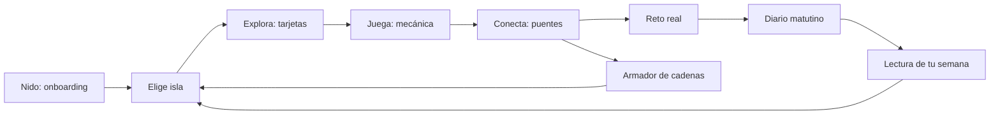

# 03 · Diseño de juego

**Versión:** 0.1 (borrador) · **Fecha:** 2026-11-05 · **Depende de:** `01-PRD.md`, `02-contenido-y-evidencia.md`

El juego existe para **hacer entender** (causa → efecto), no para retener tiempo de pantalla. Este documento define cómo funcionan las mecánicas; el contenido de cada una vive en `02` y los datos en `05`.

---

## 1. Pilares

1. **Curiosidad antes que premio.** Lo que engancha es descubrir cómo se conectan las cosas.
2. **Agencia.** El usuario elige isla, ritmo y si juega o solo lee. No hay caminos obligatorios.
3. **Sin culpa ni presión.** Nada se pierde, nada caduca, equivocarse no cuesta nada.
4. **Honestidad.** Las mecánicas enseñan a leer evidencia (niveles, "depende", "aún se investiga").
5. **Sesiones cortas.** Una isla completa se recorre en ~6–8 minutos; el diario, en ≤ 30 segundos.
6. **El juego mide comprensión, no hábitos de sueño.** Nunca se premia dormir X horas.

---

## 2. Bucles de juego

| Bucle | Duración | Qué hace el usuario | Qué recibe |
|---|---|---|---|
| **Micro** | 5–20 s | Lee una tarjeta, toca "Ver fuente", responde un ítem | Comprensión inmediata + etiqueta de evidencia |
| **Isla** | 6–8 min | Llegada → Explora → Juega → Conecta → Reto | Sello de isla; puentes disponibles |
| **Cadena** | 2–4 min | Arma una cadena causa → efecto | Sello de puente; resumen con el eslabón más débil |
| **Diario** | ≤ 30 s | Registra cómo durmió y cómo amaneció | Sello de diario; lectura de su semana (v0.2) |
| **Macro** | Días | Explora → prueba un reto → registra → ve su patrón | Comprensión aplicada a su vida |

---

## 3. Estructura de la isla (5 etapas)

| # | Etapa | Duración | Qué ocurre | Se guarda | Se considera hecha cuando… |
|---|---|---|---|---|---|
| 1 | **Llegada** | ~30 s | Nubi presenta la isla en 2–3 frases | `stage.llegada` | Se ve la última frase |
| 2 | **Explora** | ~2 min | 3–5 tarjetas, una idea por tarjeta, con "Ver fuente" | Índice de tarjeta, fuentes abiertas | Se llega a la última tarjeta |
| 3 | **Juega** | ~2–3 min | Mecánica(s) de la isla (mito o realidad, quiz, simulador, detective…) | Completado de la mecánica | Se termina al menos una mecánica |
| 4 | **Conecta** | ~1 min | Puentes entrantes y salientes con nivel de evidencia; acceso al armador | Puentes vistos | Se abre la lista de puentes |
| 5 | **Reto** | ~30 s | Se propone una acción pequeña para esa noche | `challenge.acceptedAt` | Se acepta el reto (o se elige "ahora no") |

**Reglas:**
- Las etapas van en orden por defecto, pero un indicador permite saltar a cualquiera. La app recuerda el avance y retoma donde quedó.
- Salir en cualquier momento no pierde progreso.
- "Ahora no" en el reto es una respuesta válida y no bloquea el sello de isla de **aprendizaje** (ver §4).
- Cada etapa debe poder completarse sin arrastrar, sin audio y sin límite de tiempo.

---

## 4. Pasaporte y progresión

### Sellos

| Sello | Se gana por | Cantidad en el MVP |
|---|---|---|
| **Bienvenida** | Terminar el onboarding | 1 |
| **Isla** | Completar las etapas 1–4 de una isla | 5 (Reloj, Horarios, Ánimo, Cerebro, Taller) |
| **Reto** | Aceptar el reto de una isla | hasta 5 |
| **Puente** | Armar correctamente una cadena `C-xx` por primera vez | 4 (C-01…C-04) |
| **Curiosidad** | Abrir "Ver fuente" en 3 tarjetas distintas (I) y en 8 (II) | 2 |
| **Diario** | Registrar 3 mañanas (I) y 7 mañanas (II), **no necesariamente seguidas** | 2 |
| **Experimento** | Completar una semana del Taller registrando al menos 3 días el "¿lo probaste?" | 1 |
| **Zona** | Tener todos los sellos de isla de la zona | 4 |

**Regla de oro de las recompensas:** se premia **aprender** (leer, entender, armar cadenas), **probar** (aceptar y registrar un reto) y **mirar la evidencia** (abrir fuentes). Nunca se premia haber dormido cierto número de horas ni haber tenido éxito en un reto.

### Recompensas cosméticas
Al completar una **zona**, Nubi recibe un accesorio (gorro de dormir, bufanda de estrellas, lentes de luna…). Es solo estético, sin efectos en la app.

### Progresión
- **Nada se bloquea por progreso.** Todas las islas disponibles están abiertas desde el inicio.
- **Ruta sugerida:** Nido → Reloj → Horarios → Ánimo → Cerebro → Taller, marcada con una línea de nubes. Al terminar una isla, Nubi propone la siguiente.
- Las islas no disponibles aparecen "en construcción" (niebla) y no abren contenido.

---

## 5. Mecánica estrella: **MEC-01 Armador de cadenas**

### 5.1 Idea
Una cadena es una secuencia de nodos unidos por puentes (`02` §5). El usuario arma una cadena causa → efecto y la app la valida contra el grafo. El resultado muestra **qué tan sólido es cada eslabón**.

### 5.2 Modos

| Modo | Fase | Descripción |
|---|---|---|
| **Guiado** | MVP | La cadena tiene 1–2 huecos; el banco ofrece 3–4 piezas |
| **Libre** | MVP | Se da un nodo de inicio y uno de llegada; el banco tiene 6–9 piezas (incluye distractores); se arma el camino |
| **Descubre** | v0.2 | Solo se ven los extremos; hay que encontrar el camino explorando |

### 5.3 Interacción
- **Disposición:** eslabones en columna (móvil), unidos por puentes de nubes. Piezas en un banco inferior.
- **Colocar una pieza:** tocar la pieza y luego el hueco, **o** arrastrar. Ambas formas siempre disponibles.
- **Quitar:** tocar la pieza colocada.
- **Teclado:** `Tab` entre huecos y banco; `Enter` selecciona/coloca; `Esc` cancela. El lector de pantalla anuncia "Eslabón 2 de 4, vacío" y "Pieza: Te da sueño más tarde".
- **Botón "Probar cadena"** activo cuando todos los huecos están llenos.

### 5.4 Validación (regla)
Para cada par consecutivo `(a, b)` de la cadena propuesta:
1. Debe existir una arista `a → b` en el grafo.
2. La arista no puede estar en estado `pendiente`.

Resultados: **correcta** (todos los pares válidos), **parcial** (algunos válidos) o **incorrecta** (ninguno).
Si hay varios caminos válidos entre los extremos, **todos se aceptan**; la app puede mostrar "¡Hay otro camino!" con el camino alternativo.

### 5.5 Retroalimentación por eslabón

| Caso | Se muestra | Plantilla de Nubi |
|---|---|---|
| Eslabón válido | ✔ + etiqueta de evidencia + explicación de 1 línea (del puente) | "Estos dos sí se conectan. {explicación}" |
| Eslabón no válido | ✖ + pista (sin revelar la respuesta completa) | "Mmm, estos dos no están conectados así en lo que sabemos. ¿Qué podría ir en medio?" |
| Cadena correcta | Resumen completo | "¡Lo lograste! Mira qué tan sólida es tu cadena." |
| Cadena parcial | Marca los eslabones válidos | "Vas bien. Revisa el {n}.º eslabón." |

### 5.6 Resumen final (lo que enseña)
- Lista de eslabones con su etiqueta (● Bien establecido / ◐ Probable / ○ Aún se investiga).
- Destaca el **eslabón más débil** y explica por qué: "Esta parte aún se investiga: los estudios no coinciden / es una interpretación que une varios estudios".
- Nunca presenta la cadena como "lo que te va a pasar", sino como "lo que se ha visto en estudios".

### 5.7 Ayudas (sin penalización)
1. **Nivel 1:** Nubi recuerda el tema de la isla.
2. **Nivel 2:** resalta la pieza correcta del primer hueco.
3. **Nivel 3:** resalta el siguiente puente a completar.

### 5.8 Dificultad
- Distractores: **nodos reales del grafo** que no se conectan directamente en ese orden. **Nunca** inventar afirmaciones falsas como distractores.
- Longitud: 3–5 eslabones.
- Los intentos fallidos no se muestran como contador ni se guardan.

### 5.9 Datos que guarda
Solo `chainId` y `solvedAt` (ver `05` §5). No se guardan intentos, ayudas ni errores.

### 5.10 Cadenas del MVP
`C-01` Del reloj al ánimo · `C-02` Colegio temprano y ánimo · `C-03` La cadena del estudio (hipótesis integrada) · `C-04` Del fin de semana a la recompensa. Detalle en `02` §5.3.

---

## 6. Catálogo de mecánicas

| ID | Mecánica | Islas | Fase |
|---|---|---|---|
| **MEC-01** | Armador de cadenas | Todas (desde Conecta) | MVP |
| **MEC-02** | Mito o realidad | Reloj, Horarios, Ánimo, Cerebro | MVP |
| **MEC-03** | Mini quiz | Reloj, Ánimo | MVP |
| **MEC-04** | Arma tu semana (simulador de horas) | Horarios | MVP |
| **MEC-05** | Detective de estudios | Cerebro | MVP |
| **MEC-06** | Constructor de rutina (experimento de 7 días) | Taller | MVP |
| **MEC-07** | Respiración con Nubi | Taller | MVP |
| **MEC-08** | Noche y mañana | Taller / Mirador | v0.2 |

### MEC-02 · Mito o realidad
- Muestra una afirmación. El usuario elige **Mito**, **Realidad** o **Depende** (tocando o deslizando).
- Después aparece la explicación, la etiqueta de evidencia y el botón "Ver fuente".
- 3–5 ítems por sesión, sin cronómetro, sin puntaje visible.
- La opción **Depende** existe porque parte de la evidencia es mixta (por ejemplo `MR-02`).
- Cada ítem referencia sus fichas (`02` §6).

### MEC-03 · Mini quiz
- 3 preguntas de opción múltiple por isla, con explicación breve.
- Reintentos ilimitados; el resultado es privado ("3 de 3") y no se guarda como puntaje.
- Las preguntas se basan solo en afirmaciones con ficha.

### MEC-04 · Arma tu semana
- Entradas: hora de acostarse y de levantarse entre semana, y lo mismo en fin de semana.
- Salida: horas de sueño de cada tipo de día, sobre una barra con la **banda de 8–10 h** (EV-001) sombreada, y la **diferencia** entre semana y fin de semana como dato neutro.
- Texto: "Entre semana duermes X h; el fin de semana, Y h. Para tu edad se recomienda entre 8 y 10 h."
- Sin juicios ni colores de alarma; no se guarda.

### MEC-05 · Detective de estudios
1. Se presentan 3–4 estudios anónimos ("Estudio A, B, C…") con sus datos (cuántas noches, qué midieron, edades).
2. El usuario los clasifica: **"Se vio efecto"** / **"No se vio efecto"**.
3. Luego elige qué **cambia entre ellos** (noches, qué midieron, edades).
4. Se revela la explicación como **hipótesis plausible**, no probada (`EV-C01`) y se descubren las fuentes.
- Enseña a leer evidencia mixta sin decir que "una noche corta no importa" (ver cierre obligatorio de Isla Cerebro).

### MEC-06 · Constructor de rutina
1. El usuario elige **hasta 3 experimentos** de la lista del Taller (`02` §6).
2. La app los registra como experimento activo de 7 días.
3. En el diario aparece cada mañana "¿lo probaste?" (Sí / Más o menos / No).
4. A los 7 días, Nubi muestra su semana sin juicios (ver §7).
- El sello se gana por registrar ≥ 3 días, no por cumplir.

### MEC-07 · Respiración con Nubi
- Nubi se expande y contrae a un ritmo lento (los parámetros viven en `/content`; `TODO(profesional)` para validarlos).
- Duración 1–3 minutos, se puede detener en cualquier momento.
- Con "reducir animaciones": se reemplaza por textos guía y una barra de progreso, sin movimiento.
- Sonido opcional y apagado por defecto.
- Se presenta como "para relajarte", **sin promesas de eficacia**.

### MEC-08 · Noche y mañana (v0.2)
- El usuario elige 1–3 decisiones de la noche de una lista corta definida en `/content`.
- La app muestra, para cada una, **efectos posibles al día siguiente** usando solo puentes con ficha, con su etiqueta de evidencia.
- Lenguaje: "En estudios se ha visto que…", nunca "te va a pasar".
- Sin números de salud; no se guarda.

---

## 7. El diario como mecánica de cierre

**Meta:** que el usuario vea su propio patrón sin sentirse evaluado.

### Entrada matutina (≤ 30 s)
| Campo | Tipo | Obligatorio | Notas |
|---|---|---|---|
| Hora de acostarse | Selector de hora | Sí | Por defecto la de la última entrada |
| Hora de levantarse | Selector de hora | Sí | Por defecto la de la última entrada |
| Ánimo al despertar | 5 rostros con texto (Muy mal · Mal · Normal · Bien · Muy bien) | Sí | Sin colores de alarma |
| Pantallas en la cama | Sí / No | No | |
| ¿Probaste tu experimento? | Sí / Más o menos / No | Solo si hay uno activo | Las tres son válidas |

- La entrada se asocia a la **fecha de despertar** (hora local).
- La duración se calcula correctamente cuando se cruza la medianoche.
- Se puede omitir cualquier día; un día sin registro no tiene consecuencias.
- Se puede editar el registro del mismo día.
- La tarjeta del diario aparece en el mapa como invitación, nunca como interrupción.

### Lectura de la semana (v0.2)
- **Condición mínima:** ≥ 5 entradas.
- **Muestra:** rango de horas dormidas en la semana (sobre la banda 8–10 h) y, si hay ≥ 2 entradas en cada grupo, una comparación **con palabras** entre noches de menos de 8 h y de 8 h o más ("tu ánimo fue más bajo en las noches más cortas" / "no se nota diferencia en estos días").
- **Siempre incluye:** "Es solo tu semana, no un diagnóstico. No podemos saber si fue por el sueño."
- **Evita:** números de ánimo como puntaje, colores rojos, metas de horas, comparaciones con otros.

### Reto → diario → sello
Aceptar un reto (sello de Reto) → al día siguiente Nubi pregunta "¿lo probaste?" → registrar da avance en el sello de Diario o Experimento, **independientemente de la respuesta**.

---

## 8. Nubi como sistema de diálogo

### Estados
`idle` (parpadea) · `volando` (viaja entre islas) · `explicando` · `pensando` (al validar) · `celebrando` · `soñoliento` (uso nocturno) · `apoyando` (en Ayuda y en respuestas negativas).

### Reglas
- Burbujas de **≤ 140 caracteres**, máximo **3 seguidas**, siempre saltables.
- Todo texto de Nubi también está disponible como texto en pantalla (nada solo en audio).
- **Nunca regaña**, nunca compara, nunca da consejos médicos.
- Ante un error: curiosidad ("¿qué podría ir en medio?"), no corrección.
- Ante un reto no cumplido: "Gracias por contarme. Con eso también aprendemos."
- Máximo una intervención espontánea de Nubi por pantalla.

### Disparadores (resumen)
| Disparador | Respuesta |
|---|---|
| Entrar a una isla | Presentación de 2–3 frases |
| Completar una etapa | Mensaje corto y sugerencia de siguiente paso |
| Cadena correcta | Celebración + resumen |
| Primera vez en el diario | Explicación breve de cómo funciona |
| Uso nocturno (v0.2) | Una invitación a continuar mañana, una vez por sesión |
| Abrir Ayuda | Tono de apoyo ("No tienes que resolver esto solo") |

---

## 9. Ritmo de sesión y "economía"

- **No hay** energía, vidas, tiempos de espera ni monedas.
- **No hay notificaciones push** (el producto no tiene servidor). Opcional v1.0: archivo `.ics` de recordatorio.
- **Primera visita ideal:** onboarding (1 min) + una isla (6–8 min) + una cadena (2–4 min).
- **Fin de sesión:** Nubi sugiere un reto para esa noche y cierra sin pedir más.

---

## 10. Accesibilidad del juego

- Toda acción de arrastrar tiene alternativa por toque y teclado.
- Sin límites de tiempo en ninguna mecánica.
- Con "reducir animaciones", los viajes de Nubi y las transiciones pasan a desvanecimientos simples.
- La evidencia y el estado nunca dependen solo del color: ícono + texto.
- Todas las mecánicas son comprensibles con lector de pantalla (etiquetas y orden lógico).
- Textos de tamaño ajustable sin romper el juego.

---

## 11. Pruebas de juego (playtest)

**Checklist para cada ronda:**
- ¿Entienden el objetivo de cada mecánica sin explicación del facilitador?
- ¿Dónde se equivocan en el armador de cadenas y por qué?
- ¿Entienden las etiquetas de evidencia? ¿Qué creen que significa "Aún se investiga"?
- ¿Sienten que Nubi los regaña o juzga? ¿En qué momento?
- ¿Encuentran el diario y la Ayuda sin ayuda?
- ¿Cuánto tarda una isla? ¿En qué etapa se aburren?
- ¿Algún mensaje les generó preocupación o ansiedad sobre su sueño?

**Qué ajustar según los hallazgos:** longitud de tarjetas, número de piezas del banco, claridad de pistas, tono de Nubi.

---

## 12. Anti-patrones prohibidos

No se implementan, aunque "aumenten la retención":

| Prohibido | Motivo |
|---|---|
| Rachas ("llevas 5 días seguidos") o pérdida de racha | Genera ansiedad y culpa |
| Metas de horas de sueño o puntaje de "calidad de sueño" | Riesgo de ansiedad por dormir; no es un instrumento validado |
| Rankings, tablas de posiciones, comparaciones con otros | Presión social |
| Vidas, energía, tiempos de espera | Presión y fricción |
| Temporizadores de presión en juegos | Ansiedad |
| Cajas de recompensa, monedas, compras | Fuera de alcance y riesgo para menores |
| Notificaciones insistentes o mensajes de culpa | Dañan la confianza |
| Colores rojos y símbolos de alarma para noches cortas | Juicio implícito |
| Afirmaciones falsas como distractores | Desinformación |
| Contenido sobre depresión o suicidio gamificado | Seguridad (`02` §7) |

---

## 12bis. Datos que genera cada mecánica

| Mecánica | Estado guardado | Referencia |
|---|---|---|
| Etapas de isla | `progress.islands[id].stages` | `05` §5 |
| Tarjetas / fuentes abiertas | `progress.islands[id].sourcesOpened` | `05` §5 |
| MEC-01 | `progress.chains[]` (`chainId`, `solvedAt`) | `05` §5 |
| MEC-02/03/04/05/07 | Solo marca de completado | `05` §5 |
| MEC-06 | `challenges[]` / `experiments[]` | `05` §5 |
| Diario | `diary[]` | `05` §5 |
| Sellos | Derivados de los eventos anteriores | `05` §6 |
