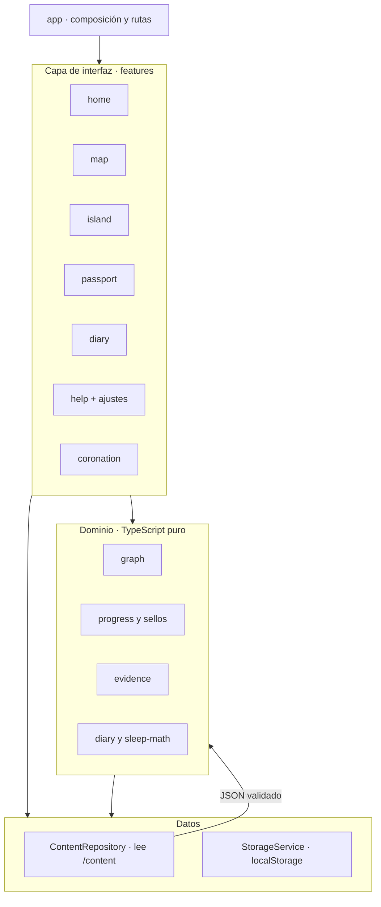

# 05 · Arquitectura técnica

**Versión:** 0.1 (borrador) · **Fecha:** 2026-11-05 · **Depende de:** `01-PRD.md`, `02`, `03`, `04`

---

> **Nota de adaptación (2026-11-08).** El framework es **React** (Vite + TypeScript estricto): ver [`../adr/013-framework-react.md`](../adr/013-framework-react.md) y la decisión D-15 en `01-PRD.md` §13. La estructura de carpetas, las capas, el presupuesto de deuda y el chequeo de límites están en [`../adr/015-arquitectura-frontend-react.md`](../adr/015-arquitectura-frontend-react.md). Las rutas, la navegación de 4 destinos y el responsive de paridad están en [`../adr/016-responsive-paridad-movil.md`](../adr/016-responsive-paridad-movil.md). El alcance v0.1 incluye Diario mínimo; onboarding queda para v1.0.

---

## 1. Decisiones técnicas (ADR)

| ID | Decisión | Razón | Alternativas descartadas |
|---|---|---|---|
| **ADR-01 · REEMPLAZADO** | ~~Angular~~ · Confirmado **React (Vite, TS estricto)** por **ADR-13** (`docs/adr/013-framework-react.md`) | Sumado por ADR-13: premisa de dominio de Angular incorrecta; el resto de la arquitectura es agnóstica | *(originales en ADR-13)* |
| **ADR-02** | **Contenido como datos** en `/content` (JSON validado por esquema), nunca dentro de componentes | Permite revisión profesional, validación automática y agregar islas sin tocar código | Textos en plantillas |
| **ADR-03** | **Persistencia local** con `localStorage` detrás de un `StorageService` versionado (`nubi:v1`), con migraciones y *fallback* en memoria | Datos pequeños; simple y suficiente; la abstracción permite pasar a IndexedDB después | IndexedDB desde el inicio (innecesario ahora); cuentas y servidor (descartado por D-04) |
| **ADR-04** | **PWA** instalable y con contenido offline. Herramienta en React: `vite-plugin-pwa` (service worker + manifest; elección final registrada en T-13 y justificada en un ADR si cambia) | Ayuda a la persistencia en iOS y al uso sin conexión (RF-18) | Solo sitio web |
| **ADR-05** | **Mapa e ilustraciones en SVG inline** con CSS/Web Animations; sin canvas ni WebGL. Interacción principal del armador: **tocar la pieza y luego el hueco + teclado** (doc 03 §5.3); el arrastre es mejora futura y no adopta dependencia (ADR-13) | Ligero, accesible, escala bien; evita dependencias de arrastre | Canvas/Phaser (peso y accesibilidad); librería de drag-drop en este corte |
| **ADR-06** | **Sin terceros:** sin analíticas, sin fuentes ni librerías desde CDN, CSP estricta, fuentes autoalojadas | Privacidad de menores (RNF-04, D-10) | Google Fonts, analíticas |
| **ADR-07** | **Validación en tiempo de build y de importación** con un esquema (`zod`) | Una sola definición de tipos y validación; cumple RF-23 | Validación manual |
| **ADR-08** | **Pruebas:** unitarias (dominio y servicios), de componentes, E2E con **Playwright**, accesibilidad con **axe**, rendimiento con **Lighthouse CI** | Calidad automática | Solo pruebas manuales |
| **ADR-09** | **Alojamiento estático con control de cabeceras HTTP** (Netlify, Cloudflare Pages o Firebase Hosting). No usar un alojamiento que no permita cabeceras personalizadas para producción | La CSP y otras cabeceras se aplican mejor por cabecera HTTP | GitHub Pages (sin cabeceras personalizadas; solo para borradores internos) |
| **ADR-10** | **Un repositorio, una app.** Node LTS, gestor de paquetes único (npm o pnpm; decidir en T-00), Conventional Commits, CI con GitHub Actions | Simplicidad | Monorepo |
| **ADR-11** | **Dependencias mínimas y fijadas** (versiones exactas y *lockfile*); toda dependencia nueva requiere justificación en un ADR | Seguridad de la cadena de suministro y peso | Añadir librerías por comodidad |
| **ADR-12** | **Runner de pruebas unitarias: Vitest** (nativo del stack Vite; prueba componentes con Testing Library) | Cero configuración extra con Vite; integra cobertura | Jasmine/Karma (legado Angular de ADR-01, ya reemplazado) |
| **ADR-13** | **React (Vite + TypeScript estricto)** reemplaza ADR-01; los ADR-02…12 siguen vigentes. Detalle completo en [`docs/adr/013-framework-react.md`](../adr/013-framework-react.md) | Quien desarrolla domina JS/React; el producto no depende del framework | Angular (curva sin razón), SvelteKit (solo si RNF-02 falla) |

---

## 2. Arquitectura lógica



**Reglas de dependencia**
1. `domain/` **no importa** el framework (React/Vite) ni accede al navegador: son funciones puras y tipos.
2. `features/` usa `domain/` y servicios de `core/`; **no** lee `localStorage` directamente.
3. Los componentes **no contienen textos de contenido**; los reciben de `ContentRepository`.
4. `shared/ui` no conoce el dominio (solo tokens y accesibilidad).

---

## 3. Estructura del repositorio

```
nubi/
├─ docs/                         # paquete documental + ADR
├─ content/
│  ├─ schema/                    # esquemas (zod) y tipos exportados
│  ├─ evidence/evidence.json     # fichas EV-xxx (doc. 02)
│  ├─ graph/{nodes,edges,chains}.json
│  └─ islands/{nido,reloj,horarios,animo,cerebro,taller}.json
├─ src/                          # SPA (React + Vite)
│  ├─ app/                       # composición raíz, rutas, layouts, transición
│  ├─ core/                      # aplicación + infraestructura del navegador
│  │  ├─ content/                # loader, repositorio y resolución de arte
│  │  ├─ storage.ts
│  │  ├─ settings.ts
│  │  ├─ user-state.ts
│  │  ├─ user-state-store.ts
│  │  └─ progress-service.ts
│  ├─ domain/                    # TypeScript puro, sin React ni DOM
│  │  ├─ graph/                  # validación de cadenas, caminos alternativos
│  │  ├─ progress/               # sellos derivados
│  │  ├─ evidence/               # niveles y compuertas
│  │  └─ diary/                  # sleep-math y lectura semanal (v0.2)
│  ├─ features/                  # una carpeta por pantalla
│  │  ├─ home/  map/  island/  passport/  diary/  help/  coronation/
│  ├─ shared/
│  │  ├─ ui/                     # primitivas de doc. 04 §6
│  │  ├─ state/                  # contexto React + useUserState
│  │  ├─ hooks/                  # foco, movimiento reducido
│  │  └─ lib/                    # utilidades sin dominio
│  ├─ styles/                    # tokens, temas, fuentes y base
│  ├─ test/                      # setup y fixtures
│  ├─ main.tsx
│  └─ vite-env.d.ts
├─ public/                       # íconos PWA, manifest y recursos estáticos
├─ licenses/                     # autores y licencias de recursos
├─ scripts/
│  ├─ validate-content.ts        # RF-23
│  └─ check-boundaries.mjs       # presupuesto de deuda (ADR-015)
├─ e2e/                          # Playwright (feature 007)
└─ .github/workflows/ci.yml
```

**Scripts requeridos (`package.json`)**

| Script | Qué hace |
|---|---|
| `start` | Servidor de desarrollo |
| `build` | Build de producción (ejecuta antes `validate:content` con la compuerta del entorno) |
| `lint` | ESLint (incluye reglas de accesibilidad de plantillas) y Prettier |
| `typecheck` | TypeScript sin emitir |
| `test` | Pruebas unitarias y de componentes |
| `e2e` | Playwright (incluye axe) |
| `validate:content` | Valida `/content` contra esquemas y compuertas (RF-23) |
| `lighthouse` | Lighthouse CI con presupuestos |

**Entornos** (`CONTENT_GATE`)

| Entorno | Compuerta de contenido | Marca visible |
|---|---|---|
| `dev` | `draft` permitido | Cinta "BORRADOR" |
| `pilot` | mínimo `source_verified` | Aviso de piloto |
| `prod` | `professional_reviewed` | Ninguna |

---

## 4. Modelo de datos de contenido

Tipos de referencia (actualizado al modelo v0.1; los esquemas `zod` en `content/schema` son la fuente de verdad y los tipos se infieren de ellos).

```ts
type EvidenceLevel = 'E1' | 'E2' | 'E3';
type ReviewStatus = 'draft' | 'source_verified' | 'professional_reviewed';
type Stage = 'llegada' | 'historia' | 'retos' | 'sello';

interface EvidenceRecord {
  id: string;                       // 'EV-003'
  claimTechnical: string;
  claimTeen: string;                // ≤ 45 palabras
  source: { citation: string; url?: string;
            sourceType: 'estudio' | 'revision' | 'posicion-oficial' | 'fuente-clinica' | 'dato-vigilancia' };
  population: string;
  design: string;
  finding: string;
  limitations: string;
  level: EvidenceLevel;
  geography: 'EE.UU.' | 'Colombia' | 'n/d';
  usedIn: string[];
  restricted: boolean;              // true => nunca se renderiza como tarjeta
  status: ReviewStatus;
  verifiedBy?: string;
  verifiedOn?: string;              // 'YYYY-MM-DD'
}

interface Escena {
  id: string;                       // 'ESC-RELOJ-1'
  acto: 'sintoma' | 'causa' | 'efecto' | 'cierre';
  texto: string;                    // ≤ 45 palabras
  alt: string;
  isHealthClaim: boolean;           // si true => evidenceId obligatorio
  evidenceId?: string;
  ilustracion?: string;             // 'arte/escenas/reloj-1.webp'
}

interface Opcion { id: string; texto: string; correcta: boolean; }

interface Pregunta {
  id: string;                       // 'PR-1'
  enunciado: string;
  opciones: Opcion[];               // 2–4; exactamente una correcta
  explicacion: string;
  isHealthClaim: boolean;
  evidenceId?: string;
}

interface Reto { chainId: string; titulo: string; huecos: 1 | 2 | 3; }

interface Isla {
  id: string;                       // 'ISL-RELOJ'
  slug: string;                     // 'reloj'
  zona: 0 | 1 | 2 | 3 | 4;          // 0 = Nido
  nombre: string;
  subtitulo: string;
  disponibilidad: 'available' | 'coming_soon';
  posicion: { x: number; y: number }; // 0–100; y se dibuja desde abajo
  ordenSugerido?: number;
  llegada?: string[];               // 2–3 frases de Nubi, ≤ 140 caracteres
  historia?: Escena[];              // 3–6 escenas si está disponible
  pregunta?: Pregunta;
  reto?: Reto;
  puentes: string[];                // ids de puentes publicados
  fuentes: string[];                // ids de fichas
}

interface GraphNode { id: string; label: string; islandId: string; }
interface GraphEdge {
  id: string;                       // 'B-06'
  from: string; to: string;
  status: 'published' | 'pending';  // 'pending' => nunca se muestra ni valida
  level?: EvidenceLevel;            // obligatorio si published
  evidenceIds: string[];
  explanation: string;              // 1 línea para el feedback del armador
  honestLabel: string;              // p. ej. 'Aún se investiga: depende de cuántas noches'
}
interface Chain {
  id: string;                       // 'C-01'
  title: string;
  mode: 'guided' | 'free';
  start: string; end: string;       // ids de nodo
  solution: string[];               // camino de referencia
  distractors: string[];            // nodos reales del grafo que no encajan en ese orden
  isIntegratedHypothesis?: boolean; // C-03
}
```

**Ejemplo (recortado)**

```json
{
  "id": "ISL-RELOJ", "slug": "reloj", "zona": 1, "nombre": "Isla Reloj",
  "subtitulo": "Tu reloj interno", "disponibilidad": "available",
  "posicion": { "x": 50, "y": 60 }, "ordenSugerido": 1,
  "llegada": ["Aquí vive el reloj de tu cuerpo.", "Vamos a ver por qué te da sueño a la hora que te da."],
  "historia": [
    { "id": "ESC-RELOJ-2", "acto": "causa",
      "texto": "En la pubertad tu reloj biológico se corre: la fase del sueño se retrasa y te da sueño más tarde.",
      "alt": "Un reloj inclinado sobre una nube",
      "isHealthClaim": true, "evidenceId": "EV-003",
      "ilustracion": "arte/escenas/reloj-2.webp" }
  ],
  "pregunta": { "id": "PR-1", "enunciado": "¿Por qué muchos adolescentes sienten sueño más tarde?",
    "opciones": [{ "id": "a", "texto": "Porque su reloj biológico se corre", "correcta": true },
                 { "id": "b", "texto": "Porque necesitan dormir menos", "correcta": false }],
    "explicacion": "En la pubertad cambian la fase del reloj y la melatonina.",
    "isHealthClaim": true, "evidenceId": "EV-003" },
  "reto": { "chainId": "C-01", "titulo": "Arma la cadena del reloj al ánimo", "huecos": 1 },
  "puentes": ["B-01", "B-02"], "fuentes": ["EV-001", "EV-003"]
}
```

**Reglas que valida `validate-content` (RF-23)**
1. Toda `Escena` o `Pregunta` con `isHealthClaim: true` tiene `evidenceId` existente y no restringido.
2. Toda arista `published` tiene `level` y al menos un `evidenceIds` existente; su `level` no es más alto que el de su ficha más débil.
3. Las aristas `pending` no se referencian desde cadenas ni islas.
4. Cada `Chain.solution` es un camino válido en el grafo y `start`/`end` coinciden con sus extremos; los `distractors` existen.
5. Ningún texto visible supera los límites (≤ 45 palabras en escenas y fichas, ≤ 140 caracteres en burbujas de Nubi).
6. El estado de cada ficha usada cumple la compuerta del entorno.
7. No hay IDs duplicados ni referencias rotas.
8. Los textos no contienen las palabras prohibidas de `02` §1 (lista configurable, con revisión manual de excepciones).
9. Cada `Pregunta` tiene exactamente una opción correcta y 2–4 opciones.
10. Cada `Reto.chainId` existe en `chains.json`.
11. Una isla `available` con `zona > 0` tiene al menos 3 escenas, pregunta y reto; una `coming_soon` puede omitirlos.

---

## 5. Estado del usuario (en el dispositivo)

Clave de almacenamiento: `nubi:v1`. **Es lo único que se guarda del usuario.** Sin identificadores, sin datos personales. `Stage` es el tipo de §4: `llegada | historia | retos | sello`.

```ts
interface UserStateV1 {
  schemaVersion: 1;
  createdAt: string;                                  // 'YYYY-MM-DD'
  profile: { nickname?: string };                     // ≤ 20 caracteres, texto plano
  settings: {
    theme: 'system' | 'light' | 'dark';
    reduceMotion: 'system' | 'on' | 'off';
    textScale: 1 | 1.25 | 1.5;
    sound: boolean;
  };
  progress: {
    onboardingDone: boolean;
    islands: Record<string, {                         // clave: id de isla
      visitedAt?: string;                             // 'YYYY-MM-DD'
      stages: Record<Stage, boolean>;
      sourcesOpened: string[];                        // ids de ficha
      mechanicsDone: string[];                        // ids MEC
    }>;
    chains: { chainId: string; solvedAt: string }[];
  };
  challenges: { islandId: string; acceptedAt: string }[];
  experiments: { id: string; startedAt: string; items: string[] }[];   // 7 días
  diary: DiaryEntry[];
}

interface DiaryEntry {
  date: string;                                       // fecha de despertar 'YYYY-MM-DD' (hora local)
  bedtime: string;                                    // 'HH:mm'
  wake: string;                                       // 'HH:mm'
  mood: 1 | 2 | 3 | 4 | 5;
  screensInBed?: boolean;
  experimentTried?: 'yes' | 'some' | 'no';
}
```

**Decisiones de datos**
- **Los sellos no se guardan:** se **derivan** del estado y del contenido (§6). Así no se desincronizan cuando cambia el contenido.
- **Fechas y horas en hora local**, como texto (`YYYY-MM-DD`, `HH:mm`), sin zonas horarias.
- Del armador solo se guarda `chainId` y `solvedAt` (no intentos ni ayudas).
- **Apodo:** se renderiza siempre como texto (interpolación escapada); nunca `innerHTML`.

### StorageService (contrato)

| Método | Comportamiento |
|---|---|
| `load()` | Lee `nubi:v1`; si no existe, devuelve `null`; si está corrupto, lo **respalda** en `nubi:v1:corrupt` y empieza limpio |
| `save(state)` | Guarda con *debounce* (≈ 300 ms) dentro de `try/catch`; maneja cuota excedida |
| `clear()` | Elimina todas las claves `nubi:*` (RF-17) |
| `exportJson()` | Devuelve un archivo con `schemaVersion` |
| `importJson(text)` | Valida con el esquema; **no modifica nada si falla**; migra versiones anteriores; pide confirmación antes de reemplazar |
| `available` (estado observable del servicio) | `false` si el almacenamiento falla: la app sigue funcionando **en memoria** y muestra un banner con la opción de exportar |
| `requestPersistence()` | Llama a `navigator.storage.persist()` si existe (detección de característica) |

**Migraciones:** mapa `{ [fromVersion]: (old) => new }` con pruebas por cada versión.

---

## 6. Lógica de dominio clave

### 6.1 Grafo y cadenas (`domain/graph`)

```ts
type Level = 'E1' | 'E2' | 'E3';
const rank: Record<Level, number> = { E1: 1, E2: 2, E3: 3 };

interface LinkResult { from: string; to: string; valid: boolean; edgeId?: string; level?: Level }
interface ChainResult {
  status: 'correct' | 'partial' | 'incorrect';
  links: LinkResult[];
  weakest?: Level;                 // el nivel más bajo entre los eslabones válidos
}

export function validateChain(nodeIds: string[], edges: GraphEdge[]): ChainResult {
  const published = edges.filter(e => e.status === 'published');
  const links = nodeIds.slice(0, -1).map((from, i) => {
    const to = nodeIds[i + 1];
    const edge = published.find(e => e.from === from && e.to === to);
    return { from, to, valid: !!edge, edgeId: edge?.id, level: edge?.level };
  });
  const validCount = links.filter(l => l.valid).length;
  const status = validCount === links.length ? 'correct'
              : validCount === 0 ? 'incorrect' : 'partial';
  const levels = links.filter(l => l.level).map(l => l.level!);
  const weakest = levels.length ? levels.reduce((a, b) => (rank[a] <= rank[b] ? a : b)) : undefined;
  return { status, links, weakest };
}

// Caminos alternativos entre dos nodos: búsqueda en profundidad sin ciclos, solo aristas 'published'.
export function findPaths(start: string, end: string, edges: GraphEdge[], maxLen = 6): string[][];
```

**Pruebas obligatorias:** cadena correcta (`C-01`); cadena con un par inválido (parcial); cadena sin pares válidos; caminos alternativos entre `N-POCO-SUENO` y `N-RETENCION` (directo por `B-10` y largo por `B-06→B-11→B-12→B-13`); arista `pending` nunca válida; nodo inexistente.

### 6.2 Duración del sueño (`domain/diary/sleep-math`)

```ts
export function sleepMinutes(bed: string, wake: string): number | null {
  const toMin = (t: string) => { const [h, m] = t.split(':').map(Number); return h * 60 + m; };
  const diff = (toMin(wake) - toMin(bed) + 1440) % 1440;
  return diff === 0 ? null : diff;             // igual hora => ambiguo
}
export const isPlausible = (min: number) => min >= 60 && min <= 16 * 60;  // si no, pedir confirmar
```

| Acostarse | Levantarse | Resultado |
|---|---|---|
| 23:30 | 06:00 | 390 min |
| 01:00 | 07:00 | 360 min |
| 22:00 | 06:30 | 510 min |
| 06:00 | 06:00 | `null` (ambiguo) |
| 08:00 | 08:30 | 30 min (no plausible: confirmar) |

### 6.3 Sellos derivados (`domain/progress`)

`deriveStamps(state, content)` devuelve la lista de sellos ganados. Reglas v0.1:

| Sello | Regla |
|---|---|
| Isla `X` (incluye Nido) | `progress.islands[X].stages.sello === true` |
| Pasaporte | Los 6 sellos de isla (Nido, Reloj, Horarios, Ánimo, Cerebro, Taller) |
| Coronación | Pasaporte completo; habilita `/coronacion` |

Reglas de v0.2 (no implementar todavía): Reto, Puente, Curiosidad I/II, Diario I/II, Experimento y Zona. Los accesorios de Nubi se derivan de los sellos de zona. **No se premia ningún valor de horas dormidas.**

### 6.4 Lectura de la semana (`domain/diary/insights`, v0.2)

```
si entradas(últimos 7 días) < 5            → estado "faltan datos"
duraciones = sleepMinutes de cada entrada
rango = [min, max] en horas
cortas = entradas con duración < 480 min ; largas = entradas con duración ≥ 480 min
si |cortas| ≥ 2 y |largas| ≥ 2:
    diff = promedio(mood de largas) − promedio(mood de cortas)
    diff ≥ 1   → "tu ánimo fue más bajo en las noches más cortas"
    |diff| < 1 → "no se nota diferencia en estos días"
    diff ≤ −1  → "tu ánimo fue más alto en las noches más cortas"
sino → solo se muestra el rango de horas
siempre → aviso: "Es solo tu semana, no un diagnóstico. No podemos saber si fue por el sueño."
```
El texto nunca incluye puntajes numéricos de ánimo ni colores de alarma. Los umbrales viven en `/content/ui` para ajustarlos sin tocar código.

---

## 7. Rutas

| Ruta | Pantalla |
|---|---|
| `/` | Portada |
| `/mapa` | Mapa + barra inferior |
| `/pasaporte` | Pasaporte (hoja modal sobre el mapa) |
| `/diario` | Diario (página de una columna; entrada v0.1, semana v0.2) |
| `/isla/:slug/:etapa` | Isla (`llegada`, `historia`, `retos`, `sello`) en hoja modal; la etapa vive en la URL |
| `/isla/:slug` | Redirige a `llegada` o abre niebla si es `coming_soon` |
| `/ayuda` | Ayuda + ajustes (página con barra inferior) |
| `/coronacion` | Coronación (solo con 6/6 sellos; si faltan, redirige a `/pasaporte`) |
| `*` | Pantalla "no encontrada" con volver al mapa |

- **Composición:** una sola columna centrada (480/560/640). Barra inferior de 4 destinos en móvil y desktop; sin riel ni panel lateral.
- **Hojas:** mapa, pasaporte, isla y niebla comparten `MapLayout`; el mapa queda montado y se marca `inert`/`aria-hidden` mientras la hoja modal está abierta. La hoja es `dialog` modal en ambos.
- **Páginas:** Diario y Ayuda usan `PageLayout` (barra + main); Coronación usa `ImmersiveLayout` (sin barra).
- **DOM:** `nav → main → dialog`; el skip link salta al main.
- Carga diferida (*lazy loading*) por *feature*.
- El alojamiento debe **reescribir todas las rutas a `index.html`** (SPA).
- Enlaces con ancla (`#nombre`) solo para secciones simples; sin datos sensibles en la URL.

---

## 8. Seguridad y privacidad

**Cabeceras HTTP (producción)**

```
Content-Security-Policy: default-src 'self'; script-src 'self'; style-src 'self' 'nonce-{NONCE}';
  img-src 'self' data:; font-src 'self'; connect-src 'self'; manifest-src 'self'; worker-src 'self';
  base-uri 'self'; form-action 'self'; frame-ancestors 'none'
Referrer-Policy: no-referrer
X-Content-Type-Options: nosniff
Permissions-Policy: camera=(), microphone=(), geolocation=(), payment=()
Strict-Transport-Security: max-age=31536000; includeSubDomains   (si el hosting lo gestiona)
```

> **Nota React/Vite (CSP):** Vite no inlinea CSS crítico como Angular, pero el build emite `<script>` de tipo módulo y *preloads* con rutas firmadas que son compatibles con `script-src 'self'`. Verificar: que ningún plugin inlinee estilos o scripts en el HTML final, que las fuentes se sirvan desde `/` (ya decidido: autoalojadas) y probar la CSP en el build de producción (T-15). Si se necesita insertar algo inline (no debe), usar *nonce* generado por el hosting con cuidado.

**Reglas**
1. **Sin cookies, sin terceros, sin analíticas, sin fuentes remotas.**
2. No usar `innerHTML` ni `bypassSecurityTrust*` con datos del usuario.
3. Enlaces externos (fuentes): `target="_blank"` con `rel="noopener noreferrer"` y texto "se abre en una pestaña nueva".
4. Dependencias: versiones exactas, `npm audit` en CI, revisión de cada dependencia nueva (ADR-11).
5. El archivo de importación se valida con el esquema; nunca se ejecuta ni se inserta como HTML.
6. **Aviso de privacidad** (pantalla Acerca): qué se guarda, dónde (solo en el dispositivo) y cómo borrarlo.
7. Piloto con menores: sin recolección de datos personales dentro de la app (ver PRD §12).

---

## 9. Rendimiento y presupuestos (RNF-02)

| Métrica | Objetivo |
|---|---|
| JS inicial | ≤ 250 KB **gzip** *(los presupuestos de Vite/CI suelen medirse sin comprimir: calcular el equivalente gzip con un script de build o el reporte de bundle)* |
| Fuentes | ≤ 60 KB total (`woff2`, subconjunto) |
| LCP | ≤ 2,5 s en 4G simulado, dispositivo de gama media |
| INP | ≤ 200 ms |
| Lighthouse (móvil) | Rendimiento ≥ 90 · Accesibilidad = 100 · Mejores prácticas ≥ 95 |
| SVG de ilustración | ≤ 20 KB cada uno |

Medidas: carga diferida por *feature*, render barato en re-render (memoización donde haga falta), SVG sin filtros pesados, sin imágenes de mapa de bits en el camino crítico, animaciones con `transform`/`opacity`, pausa de animaciones al ocultar la pestaña.

---

## 10. Estrategia de pruebas

| Nivel | Qué prueba | Obligatorio |
|---|---|---|
| **Unitarias (dominio)** | `validateChain`, `findPaths`, `sleepMinutes`, `deriveStamps`, insights, migraciones, importación/exportación | Cobertura ≥ 90 % en `domain/` |
| **Servicios** | `StorageService`: almacenamiento no disponible, cuota excedida, dato corrupto, importación inválida | Sí |
| **Componentes** | `EvidenceBadge`, `ChainSlot`, `MoodPicker`, `TimePicker`, `SourceSheet` (teclado y foco) | Sí |
| **Contenido** | `validate-content` con casos buenos y defectuosos | Sí |
| **E2E (Playwright)** | (1) Onboarding → mapa; (2) completar Isla Reloj; (3) armar `C-01` con teclado; (4) registrar diario y ver sello; (5) exportar → borrar → importar; (6) modo sin conexión | Sí |
| **Accesibilidad** | axe en cada pantalla (tema claro y oscuro) + revisión manual con teclado y lector de pantalla | Sí |
| **Rendimiento** | Lighthouse CI con presupuestos | Sí |
| **Usabilidad** | Piloto (PRD §12) | H7 |

---

## 11. CI/CD

**Pipeline (en cada *pull request*):** instalar con *lockfile* → `lint` → `typecheck` → `validate:content` (compuerta del entorno) → `test` → `build` → `e2e` + axe → `lighthouse` → *preview* del despliegue.
**Despliegue:** `main` → *staging* (`dev`); etiqueta `pilot-*` → entorno `pilot`; etiqueta `v*` → `prod` (solo con compuerta `professional_reviewed`).
**Bloqueos:** una PR no se fusiona si falla cualquier paso o si cambia contenido de salud sin ficha actualizada.

---

## 12. Plan de implementación para agentes

### Tareas (orden sugerido)

| ID | Tarea | Depende de | Entregable | Criterios de aceptación |
|---|---|---|---|---|
| **T-00** | Andamiaje | — | Proyecto React (Vite) con TypeScript estricto, ESLint (+ reglas de accesibilidad en JSX), Prettier, carpetas de §3, CI base, runner Vitest (ADR-12) | `lint`, `typecheck`, `test`, `build` pasan en CI |
| **T-01** | Tokens, temas y fuentes | T-00 | Variables CSS de `04` §3, tema claro/oscuro/sistema, fuentes autoalojadas | Pares de color con pruebas de contraste; sin peticiones a terceros |
| **T-02** | Esquemas y validador de contenido | T-00 | `content/schema`, `validate-content`, datos de ejemplo | Cumple las 8 reglas de §4; la build falla con casos defectuosos (con pruebas) |
| **T-03** | Servicios núcleo | T-00 | `StorageService`, `SettingsService`, exportar/importar, migraciones | Pruebas de §10 (almacenamiento no disponible, corrupto, importación inválida) |
| **T-04** | Biblioteca UI | T-01 | Componentes de `04` §6 + página interna `/dev/ui` (solo en `dev`) | axe sin violaciones críticas; foco y teclado completos |
| **T-05** | Navegación y mapa | T-02, T-03, T-04 | Router, barra inferior, mapa generado desde `/content`, estados de isla, vuelo de Nubi, lista accesible | Todas las islas del MVP se muestran; "en construcción" sin contenido; funciona con "reducir animaciones" |
| **T-06** | Runtime de isla | T-05 | 5 etapas, tarjetas, `EvidenceBadge`, `SourceSheet`, persistencia de progreso | Se retoma donde quedó; ninguna tarjeta de salud sin ficha; E2E de la Isla Reloj |
| **T-07** | Mecánicas MEC-02/03/04/05 | T-06 | Mito o realidad, quiz, arma tu semana, detective | Todo funciona sin arrastrar; reglas de `03` §6 |
| **T-08** | Grafo y armador (MEC-01) | T-06 | `domain/graph` + interfaz, cadenas C-01…C-04 | Pruebas de §6.1; teclado completo; feedback por eslabón; resumen con eslabón más débil |
| **T-09** | Reto y diario | T-06 | Aceptar reto, diario mínimo, `sleep-math` | Pruebas de §6.2; edición el mismo día; "¿lo probaste?" |
| **T-10** | Pasaporte y sellos | T-08, T-09 | `deriveStamps`, pantalla de pasaporte, accesorios | Pruebas de §6.3; sin rachas ni pérdidas |
| **T-11** | Ayuda, fuentes, ajustes, datos, acerca | T-03, T-04 | Pantallas S-14…S-19 | "Borrar mis datos" con doble confirmación; exportar/importar probados; línea de ayuda `TODO(verificar)` |
| **T-12** | Taller: MEC-06 y MEC-07 | T-09 | Constructor de rutina, respiración con alternativa sin movimiento | Experimento de 7 días enlazado al diario |
| **T-13** | PWA y offline | T-06 | Service worker, manifest, íconos, aviso de instalación | Instalable; contenido offline tras la primera carga |
| **T-14** | Contenido del MVP | T-02 | `/content` completo según `02` (estado `draft`) | Validador verde en `dev`; textos dentro de límites |
| **T-15** | Endurecimiento | T-05…T-14 | CSP, a11y manual, rendimiento, E2E completos | Cumple RNF-01…RNF-05 y presupuestos de §9 |
| **T-16** | Build de piloto | T-15 | Entorno `pilot`, checklist de piloto | Compuerta `source_verified` activa; aviso de piloto visible |

### Plantilla de tarea para un agente

```
# T-xx · <título>

## Contexto (leer antes)
- docs/01-PRD.md: RF-xx, RNF-xx
- docs/0x-….md: secciones relevantes

## Objetivo
<una frase>

## Alcance
- Incluye: …
- NO incluye: …

## Archivos permitidos
- src/… ; content/… ; e2e/…
(No tocar otros sin avisar.)

## Criterios de aceptación
- [ ] …
- [ ] Pruebas unitarias/E2E añadidas y pasando
- [ ] axe sin violaciones críticas (claro y oscuro)
- [ ] Sin textos de contenido en componentes
- [ ] Sin dependencias nuevas (o con ADR)
- [ ] Documentación actualizada si cambia un comportamiento

## Restricciones
- Seguir "Reglas para agentes" de docs/00-README.md
- Ante ambigüedad: TODO(decisión) y avisar
```

### Ejemplo (T-08, abreviado)

```
# T-08 · Armador de cadenas (MEC-01)
Contexto: PRD RF-07; docs/03 §5; docs/02 §5; docs/05 §4 y §6.1
Objetivo: permitir armar y validar las cadenas C-01…C-04 contra el grafo.
Alcance: incluye modo guiado y libre, pistas de 3 niveles, resumen con el eslabón más débil.
         NO incluye modo "Descubre" (v0.2) ni puntajes.
Archivos: src/domain/graph/**, src/features/chain-builder/**, e2e/chain.spec.ts
Aceptación:
 - [ ] validateChain y findPaths con las pruebas de §6.1
 - [ ] Operable solo con teclado; el lector anuncia "Eslabón n de m"
 - [ ] Distractores solo son nodos reales del grafo
 - [ ] Solo se guarda chainId y solvedAt
 - [ ] Sello de puente derivado tras resolver C-01
```

### Definición de terminado (DoD) para todo cambio
1. Pasa CI completa (`lint`, `typecheck`, `validate:content`, `test`, `build`, `e2e`, `lighthouse`).
2. Cumple el checklist de accesibilidad (`04` §8) si toca interfaz.
3. No añade contenido de salud sin ficha `EV-xxx`.
4. No añade dependencias sin ADR.
5. Actualiza la documentación afectada.
6. Respeta los anti-patrones de `03` §12.

---

## 13. Convenciones de código

- **TypeScript estricto;** prohibido `any`; tipos inferidos de los esquemas.
- React: componentes funcionales pequeños; el estado persistido del usuario vive **fuera de los componentes** (`UserStateStore` + contexto mínimo); JSX sin lógica de negocio ni textos de contenido.
- **Dominio puro:** funciones sin efectos secundarios; las pruebas viven junto al archivo (`*.spec.ts`).
- Nombres: componentes en `PascalCase.tsx`; hooks en `use*.ts`; servicios, dominio y utilidades en `kebab-case.ts`; estilos de feature en `*.module.css`; pruebas en `*.spec.ts(x)`.
- **CSS Modules + tokens:** sin Tailwind; sin estilos inline salvo variables dinámicas (posición, variante).
- **Responsive de paridad:** una columna de 480/560/640; sin layouts exclusivos de desktop; hojas modales en ambos (ADR-016).
- **Fronteras:** `npm run check:boundaries` valida capas, límites de líneas, contextos y ciclos (ADR-015).
- **Ningún texto visible en componentes**: el contenido viene de `ContentRepository`; las etiquetas de UI son la excepción.
- Fechas y horas como texto local (§5); no usar zonas horarias.
- Accesibilidad: usar elementos semánticos antes que `div` con roles; etiquetas en todo control.
- Commits en formato **Conventional Commits** (`feat:`, `fix:`, `docs:`, `test:`, `chore:`).
- Una tarea = una rama = una PR pequeña.

---

## 14. Riesgos técnicos

| ID | Riesgo | Mitigación |
|---|---|---|
| **RT-01** | **Pérdida de datos en iOS Safari.** Según el comportamiento documentado de WebKit, el almacenamiento escribible por scripts de un sitio puede borrarse tras días sin interacción si no está instalado en la pantalla de inicio *(verificar en las versiones objetivo)* | PWA instalable (RF-18), aviso de instalación, `requestPersistence()`, exportar/importar visible, el diario siempre funciona en memoria si falla el almacenamiento |
| **RT-02** | Peso del bundle JS (React) en celulares de gama baja | Presupuestos (§9), carga diferida, medir en CI; reevaluar ADR-13 si no se cumple RNF-02 (SvelteKit/Preact, como ya lo preveía el propio ADR-01/13) |
| **RT-03** | CSP estricta vs. build de Vite (css/fonts inline no deseados) | Auditar el HTML/TTF de producción; si algo se inlinda por defecto, desactivarlo o usar *nonce*; probar en build de producción (T-15) |
| **RT-04** | Arrastrar y soltar poco accesible o frágil en móvil | Alternativa por toque/teclado como camino principal; arrastrar es mejora |
| **RT-05** | Rendimiento de SVG animado en el mapa | Animar solo `transform`/`opacity`; limitar elementos animados; pausar al ocultar |
| **RT-06** | Desfase entre contenido y evidencia | Compuertas en build (RF-23); estados por ficha |
| **RT-07** | Licencias de fuentes e ilustraciones | Registro en `/licenses`; revisión antes del piloto |
| **RT-08** | Cambios de esquema del estado de usuario | Versionado `schemaVersion` + migraciones con pruebas |
| **RT-09** | Importación de archivos manipulados | Validación de esquema; nunca renderizar como HTML |
| **RT-10** | Dependencia de una sola persona/agente para conocer el proyecto | Este paquete + ADR + plantilla de tarea |
